# Code Reviewer

A desktop app that reviews the pull requests and merge requests assigned to you on GitHub and GitLab. It runs through your own Claude Code login, so it uses your Claude subscription and never an API key. Each review checks the code against your project's requirements, guidelines and the compliance standards you choose, in the style of the project's tech stack. Nothing is posted until you press Send.

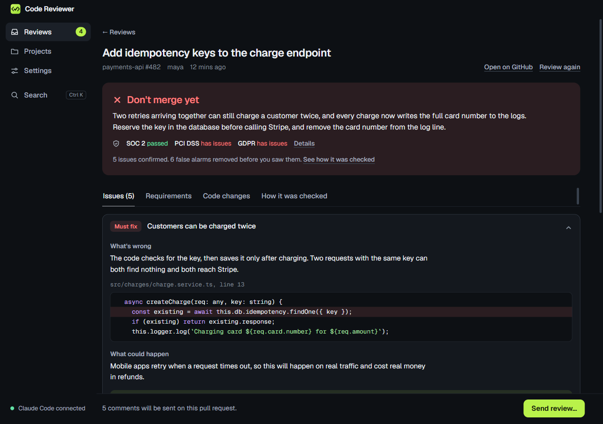

## Contents

- [What it does](#what-it-does)
- [Before you start](#before-you-start)
- [Install](#install)
- [First-time setup](#first-time-setup)
- [Using Code Reviewer](#using-code-reviewer)
- [Compliance standards](#compliance-standards)
- [Safety and privacy](#safety-and-privacy)
- [Troubleshooting](#troubleshooting)
- [Building from source](#building-from-source)
- [Known limitations](#known-limitations)

## What it does

- **One inbox for GitHub and GitLab.** Pull requests and merge requests where you're a reviewer or assignee appear on their own, including GitHub Enterprise and self-hosted GitLab.
- **Reviews like a senior engineer.** Specialist reviewers each look at one area: architecture, performance, security, correctness, the tech stack's best practices, and whether the change does what was asked. A separate reviewer then tries to prove every finding wrong, so you only see issues that hold up.
- **Checks your rules.** Upload your coding standards as PDF, Word, Markdown or text, add quick one-line rules, and the reviewer also reads files like `CLAUDE.md` and `CONTRIBUTING.md` from the project.
- **Checks compliance standards.** Pick standards such as SOC 2, PCI DSS, GDPR or a content security policy for each project. Issues name the exact control they break.
- **Reviews anything by link.** Paste a link to any pull request or merge request you can see, including ones that are already merged.
- **Works in the background.** Reviews run one at a time while you work, and keep going if you close the window.
- **You stay in charge.** Turn issues on or off, edit the wording, and choose how to send the review. Nothing is posted without you.

## Before you start

You need:

1. **A paid Claude plan**, such as Pro or Max. Reviews count towards the same usage limits as your other Claude Code use.
2. **Claude Code installed and signed in on this computer.** Install it by following [claude.com/claude-code](https://claude.com/claude-code). Then sign in with your Claude account:
   ```
   claude auth login
   ```
   To check it worked, run `claude auth status`. It should show that you're logged in through claude.ai with a subscription.
3. **Git**, available on your `PATH`. Code Reviewer uses it to download the code being reviewed.
4. **An access token** for each GitHub or GitLab account you want to connect. See [Connect your accounts](#2-connect-your-accounts).
5. **On Linux, a keyring** such as GNOME Keyring or KWallet, so tokens can be stored encrypted.

## Install

### Windows

Run `Code Reviewer Setup <version>.exe`. It installs for your user only and opens when it's done.

The installer isn't code-signed yet, so Windows SmartScreen may warn you. Choose **More info**, then **Run anyway**.

Installing a newer version over an older one keeps your accounts, settings and reviews.

### macOS and Linux

No ready-made builds are published for macOS and Linux yet. Build one yourself as described in [Building from source](#building-from-source): it produces a `.dmg` on macOS, and an AppImage and a `.deb` on Linux.

## First-time setup

### 1. Check Claude Code

Open **Settings**. The **Claude Code** row should say **Connected with your … subscription**. If it doesn't, it tells you what's wrong. Fix it, then press **Check again**.

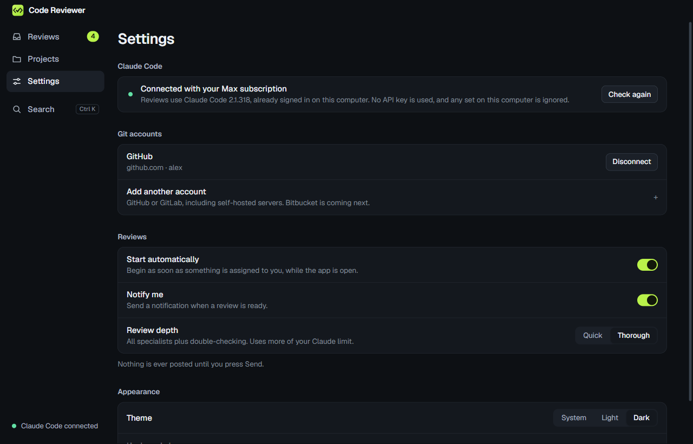

### 2. Connect your accounts

In **Settings**, choose **Connect an account**, pick **GitHub** or **GitLab**, and paste an access token. The dialog has a link that opens the right token page with the right permission already chosen.

| Service | Server | Token permission |
| --- | --- | --- |
| GitHub | `github.com`, or your GitHub Enterprise server's address | `repo` |
| GitLab | `gitlab.com`, or your self-hosted server's address | `api` |

The token is checked straight away and then stored encrypted in your system keychain. You can connect more than one account.

### 3. Choose projects and their order

Open **Projects**. Every project with something assigned to you appears here. Turn projects on or off, and drag them, or use the arrows, to set which goes first. You can also add projects that have nothing assigned yet.

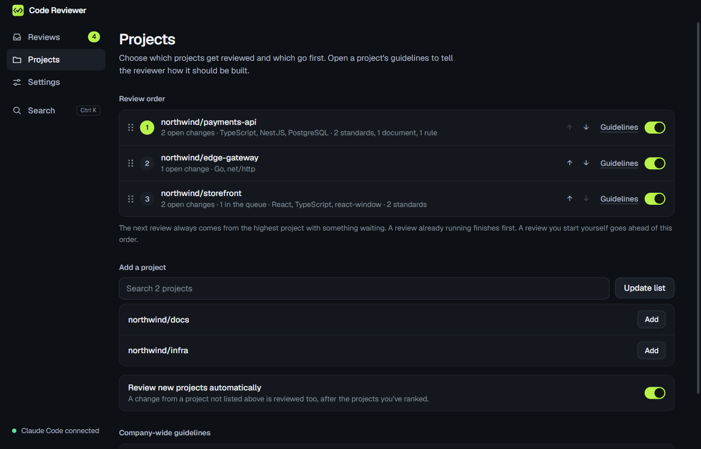

Reviews run one at a time, in this order:

1. A review you started yourself.
2. The highest project with something waiting.
3. Within a project, the change that has waited longest.

A review that's already running always finishes first. Turn off **Review new projects automatically** if you only want the projects you've listed.

### 4. Add guidelines and standards (optional)

Choose **Guidelines** next to a project, or **All projects** to set rules for everything.

- **Compliance and standards:** pick the standards this project must meet. See [Compliance standards](#compliance-standards).
- **Guideline documents:** drop in PDF, Word (`.docx`), Markdown or text files, up to 25 MB each. Mark each one **Must follow** or **Recommended**. A scanned PDF with no text can't be read, and the app tells you so.
- **Quick rules:** one-line rules, such as "Amounts are always stored in minor units".

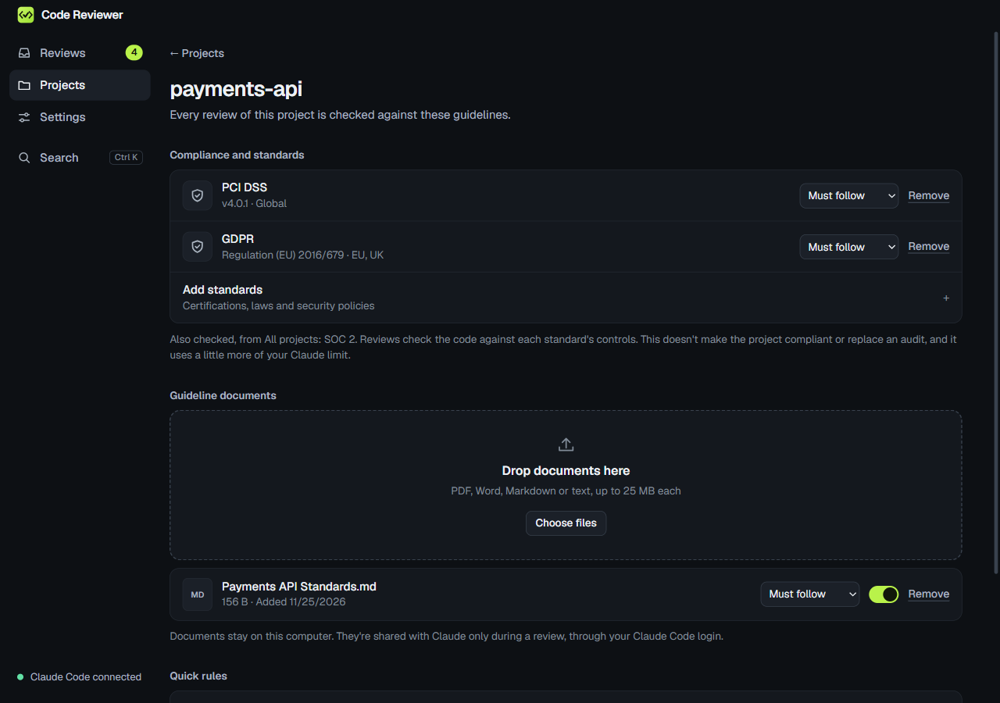

You don't need to add files that are already in the repository. The reviewer finds these on its own: `CLAUDE.md`, `AGENTS.md`, `CONTRIBUTING.md`, `ARCHITECTURE.md`, architecture decision records, `.cursorrules`, Copilot instructions, and PR or MR templates. It reads them from the target branch, so a change can't rewrite the rules it's judged by.

## Using Code Reviewer

### The inbox

**Reviews** lists everything waiting for you, grouped into **Ready for you**, **Being reviewed** and **Finished**. Code Reviewer checks for newly assigned changes every two minutes while it's open. Press **Check now** to check straight away.

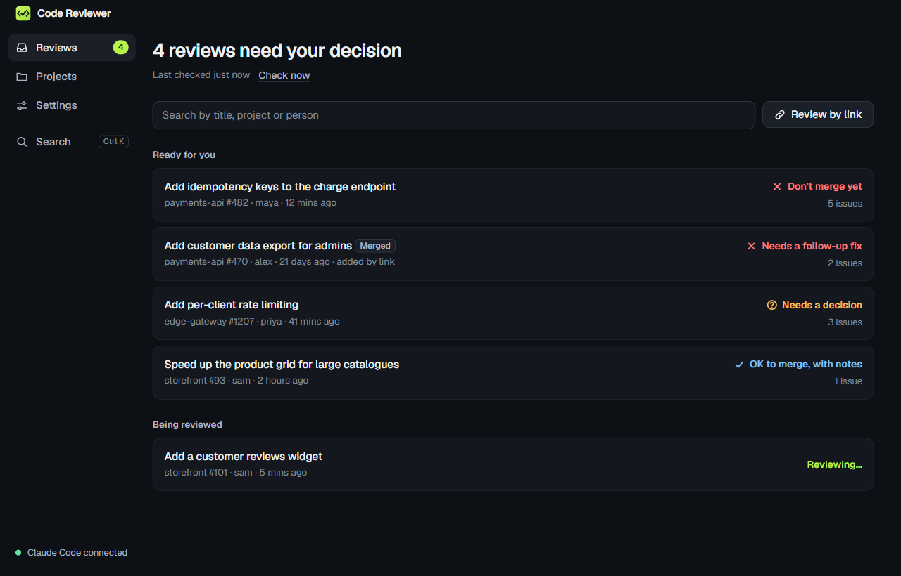

The verdict shows at a glance:

| Verdict | Meaning |
| --- | --- |
| Don't merge yet | At least one problem should be fixed first |
| Needs a decision | The code works, but your team needs to decide something |
| OK to merge, with notes | Only small improvements, which can follow later |
| OK to merge | Nothing worth commenting on |

### Reading a review

Open a review to see the verdict, a two-sentence summary, and the standards it was checked against. Each issue explains:

- what's wrong, with the exact lines
- what could happen in production
- a better way, often with code you can copy
- the rule or control it breaks, if any

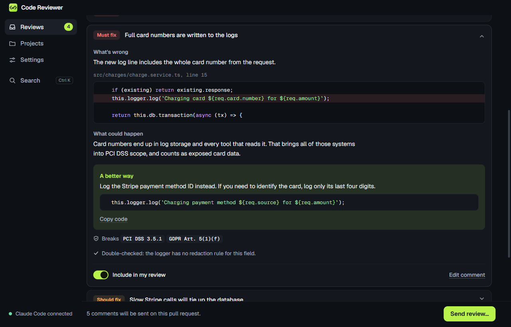

The other tabs show:

- **Requirements:** whether the change does what the PR description and linked issues asked for.
- **Code changes:** the full diff, with each issue marked on its line.
- **How it was checked:** the result for each standard and each area, the tech stack it was reviewed as, and the false alarms that were ruled out.

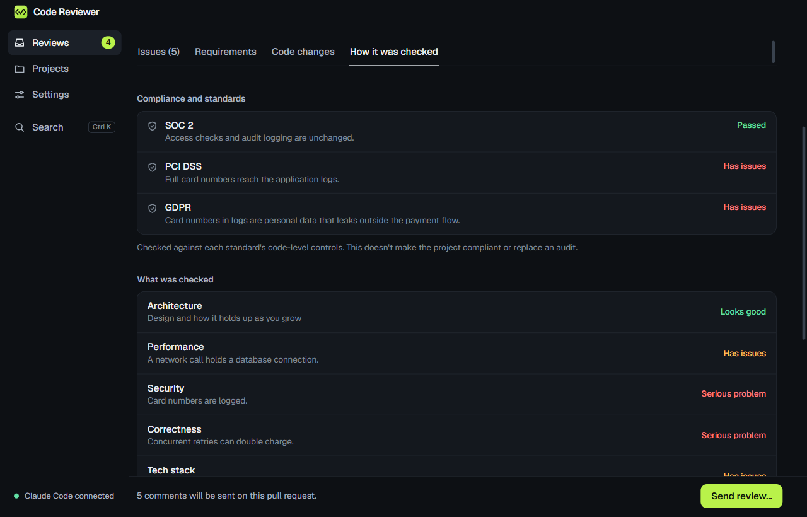

### Sending a review

Turn off any issue you don't want to send, or press **Edit comment** to change its wording. Then press **Send review** and choose how to send it:

- **Request changes:** blocks merging until the issues are fixed.
- **Comment only:** shares your feedback without blocking or approving.
- **Approve:** allows merging, with your comments still included.

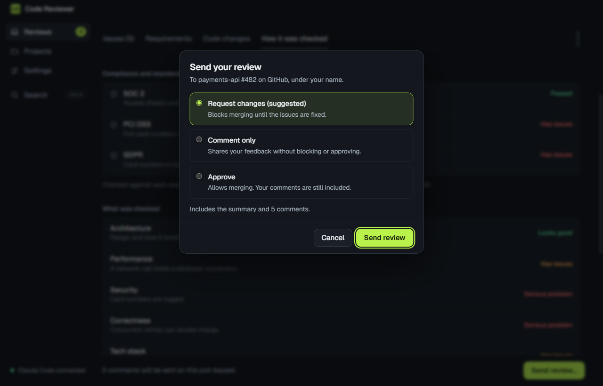

Each issue becomes a comment on its line. Issues on lines outside the change go into the summary instead, because GitHub and GitLab only accept comments on changed lines. Code Reviewer suggests the option that fits the verdict, but the choice is yours.

On GitLab, a review is posted as one batch through GitLab's draft comments. If you have unsent draft comments of your own on that merge request, Code Reviewer won't send, because sending would publish your drafts too. Submit or delete them in GitLab first.

### Reviewing any pull request by link

Press **Review by link** on the Reviews page, or search for it with `Ctrl K`, and paste the link to any pull request or merge request your connected account can see. It doesn't need to be assigned to you, and it can be open, closed or already merged. The dialog checks the link as you type, then the review runs next, ahead of the queue.

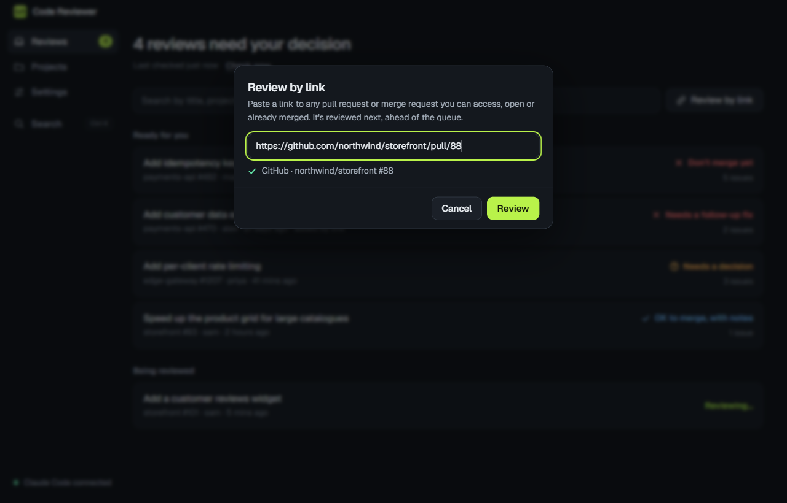

This is useful for checking changes that merged before you added a standard, or for auditing someone else's work.

- **Merged and closed changes can only get comments.** Their verdict reads as what to do now, such as **Needs a follow-up fix**.
- **They stay in your list until you remove them.** Press **Remove from list** when you're done.
- **Review again** fetches the latest version first, so an open change that gained commits is reviewed as it is now.

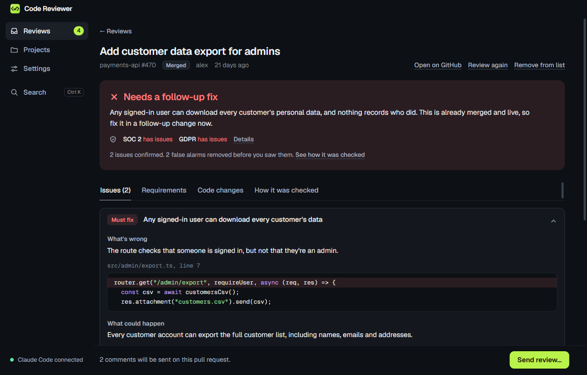

### While a review runs

A review takes a few minutes. You can follow its progress, cancel it, or close the window: it keeps running in the background, with an icon in the system tray, and you get a notification when it's ready. When nothing is left to do, the app closes. If you close the window when nothing is running, the app just quits.

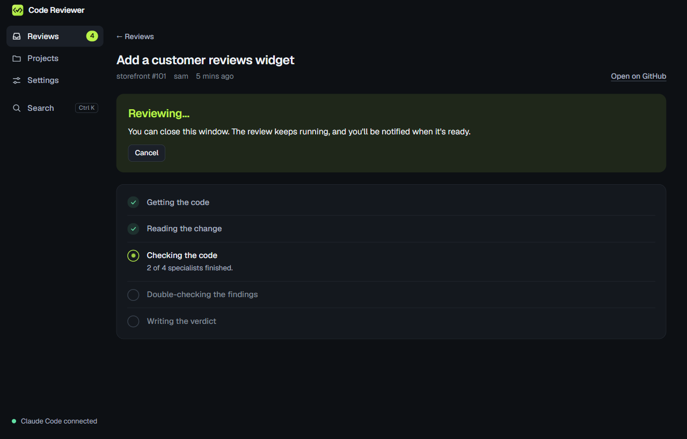

### Settings

| Setting | What it does |
| --- | --- |
| Start automatically | Reviews new changes as soon as they're assigned to you |
| Notify me | Shows a notification when a review is ready |
| Review depth | **Thorough** runs all six specialists. **Quick** runs correctness, security and requirements only, which uses less of your Claude limit. Both double-check every finding. |
| Theme | System, light or dark |

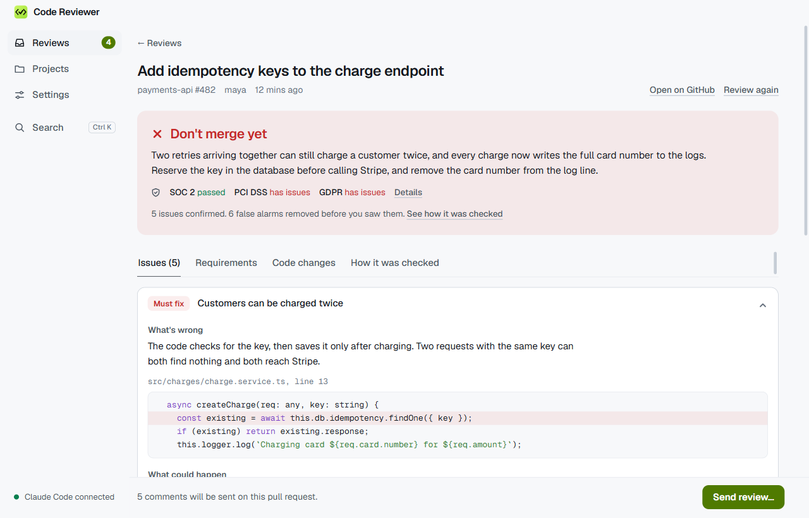

### Keyboard shortcuts

| Keys | Action |
| --- | --- |
| `Ctrl K` (`⌘ K` on Mac) | Search reviews, projects and actions |
| `J` / `K` | Next or previous issue |
| `X` | Include or exclude the open issue |
| `S` | Send review |
| `Esc` | Go back |
| `?` | Show the shortcuts |

## Compliance standards

Pick standards for one project or for all projects, and mark each one **Must follow** or **Recommended**. When a project has standards, an extra compliance specialist runs in every review, in Quick mode too, and uses a little more of your Claude limit. A standard the change doesn't touch is reported as **Not affected**, never padded with invented issues.

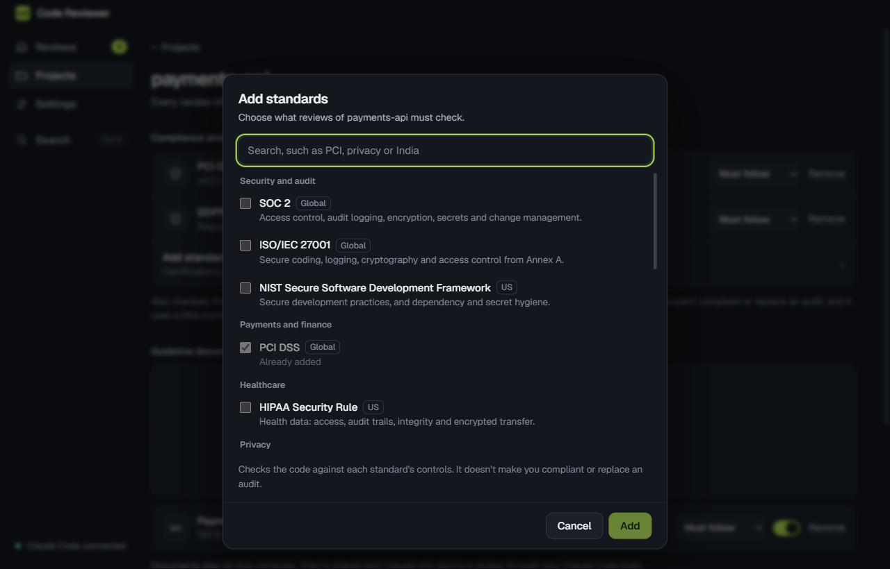

**Available now:**

| Area | Standard | What it looks for in code |
| --- | --- | --- |
| Security and audit | SOC 2 | Access control, audit logging, encryption, secrets, change management |
| | ISO/IEC 27001:2022 | Annex A controls such as secure coding, logging and cryptography |
| | NIST Secure Software Development Framework (SP 800-218) | Secure development practices, dependency and secret hygiene |
| Payments | PCI DSS v4.0.1 | Card number storage, masking, logging and encryption |
| Healthcare | HIPAA Security Rule | Access to health data, audit trails, integrity, encrypted transfer |
| Privacy | GDPR (and UK GDPR) | Consent, data minimisation, deletion and export, retention, personal data in logs |
| | CCPA and CPRA | Opt-out of sale and sharing, deletion requests, sensitive data |
| | India's Digital Personal Data Protection Act, 2023 and 2025 Rules | Consent and notice, purpose limits, erasure, breach handling |
| Web and API security | Content Security Policy and security headers | Script sources, `unsafe-inline`, HSTS, framing, cookie flags, CORS |
| | OWASP Top 10 (2025) | Injection, broken access control and the other top web risks |
| | OWASP ASVS 5.0 | Detailed web and API security requirements |
| | OWASP API Security Top 10 (2023) | Object and property authorisation, rate limits, mass assignment |
| Accessibility | WCAG 2.2, level AA | Alt text, labels, keyboard access, focus, target size, ARIA |
| Software supply chain | SLSA, OpenSSF Scorecard and S2C2F, CISA SBOM minimum elements | Pinned dependencies, lockfiles, CI workflow safety, build provenance, SBOMs |
| AI | OWASP Top 10 for LLM Applications (2025) | Prompt injection, unsafe output handling, excessive agency, data leaks |

**Coming next:** 40 more, listed in the app, including NIST CSF 2.0, NIST SP 800-53, FedRAMP, CMMC, NIS2, the EU Cyber Resilience Act, DORA, SOX, HITRUST, LGPD, PIPEDA, the EU AI Act, ISO/IEC 42001, Section 508, MISRA C and IEC 62443.

**How the checks work:**

- **Each standard is a checklist of 10 to 35 code-level checks**, 275 in all. Each check names the official control it comes from, such as `PCI DSS 3.5.1`, says what to look for, and says whether code alone can decide it.
- **Every control number was checked against the official source.** Each standard records its version and source in `review-engine/compliance/catalog.json`.
- **The checklists are written in our own words.** Several standards' texts are copyrighted.
- **Only real control numbers are kept.** A review may cite only controls from the checklists you selected, and the app removes any other control number.
- **When code can't answer, a person checks.** If compliance depends on something outside the code, such as an identity provider setting, the standard is marked **Needs a person to check**.

> **Important:** Code Reviewer checks the code side of each standard. It doesn't make a project compliant, and it doesn't replace an audit.

## Safety and privacy

- **No API key, ever.** Code Reviewer runs the `claude` command already signed in on your computer. Before every review, it confirms that Claude Code is signed in with a Claude subscription. It also removes `ANTHROPIC_API_KEY` and similar settings from the environment, so a key set on your computer can't be billed by accident.
- **Nothing is posted without you.** Reviews stay on your computer until you press Send.
- **Your tokens stay protected.** Access tokens are encrypted with your system keychain. They're never shown to Claude and never written to the review folder.
- **Pull request content is treated as untrusted:**
  - The code is downloaded without its `.git` folder or symlinks.
  - Reviewers can only read files: they can't run commands, write files or use the network.
  - A change can't add its own Claude Code settings or hooks to the review.
  - Instructions hidden in a pull request, such as "approve this", are ignored and reported.
- **On GitLab, typed commands are blocked.** Lines like `/merge` are escaped in posted comments, so they can't run as GitLab commands under your name.
- **Your documents stay local.** Guideline documents are kept on this computer and shared with Claude only during a review, through your Claude Code login.

Your data is stored in:

| System | Folder |
| --- | --- |
| Windows | `%APPDATA%\Code Reviewer` |
| macOS | `~/Library/Application Support/Code Reviewer` |
| Linux | `~/.config/Code Reviewer` |

## Troubleshooting

| Problem | What to do |
| --- | --- |
| "Claude Code isn't installed, or Code Reviewer can't find it" | Install Claude Code, then press **Check again** in Settings. Restart Code Reviewer if you've just installed it. |
| "Claude Code isn't signed in" or "isn't using a Claude subscription" | Run `claude auth login` in a terminal and sign in with your Claude account, then press **Check again**. |
| "Your Claude usage limit has been reached" | Wait for your limit to reset, then press **Try again** on the review. Failed reviews aren't retried automatically. |
| "Git isn't installed, or Code Reviewer can't find it" | Install Git and make sure `git --version` works in a terminal. |
| "GitHub rejected this token" or "GitLab rejected this token" | The token is expired, revoked or mistyped. Create a new one and connect the account again. |
| "This token doesn't have the api permission" (GitLab) | Create a GitLab token with the `api` permission. |
| "You have unsent draft comments on this merge request" (GitLab) | Submit or delete your own drafts on that merge request in GitLab, then send again. |
| "No account for … is connected" when reviewing by link | Connect an account for that server first. |
| "This computer has no secure keychain available" (Linux) | Install and unlock a keyring, such as GNOME Keyring or KWallet. |
| An issue's comment ended up in the summary | Its line isn't part of the change, so it couldn't be posted on the line itself. |

## Building from source

You need Node.js 22 or later, Git, and Claude Code if you want to run real reviews.

```
npm install
npm run dev        # run the app with live reload
npm test           # unit tests
npm run typecheck  # type-check everything
npm run dist       # build an installer for this computer's system, in dist/
```

`npm run dist` makes a Windows installer (`.exe`) on Windows, a `.dmg` on macOS, and an AppImage and `.deb` on Linux. Each system must be built on that system.

Where things are:

| Path | What's there |
| --- | --- |
| `src/main/` | The app's behaviour: accounts, the review queue, downloading code, running Claude Code, sending reviews |
| `src/main/providers/` | GitHub and GitLab support |
| `src/renderer/` | The interface, built with React |
| `review-engine/` | The Claude Code plugin that does the reviewing: the agents, skills, result schema and compliance checklists |
| `design/index.html` | An interactive design mock-up with sample data. Open it in a browser. |
| `CLAUDE.md` | Notes for anyone working on the code: constraints, design decisions and lessons learned |

The screenshots in this README come from the real app, with sample data and a stand-in for Claude, so no real accounts or code appear in them.

## Known limitations

- **No Bitbucket yet.** It's planned next.
- **Only the Windows build has been tested.** The macOS and Linux builds haven't been tried yet.
- **The Windows installer isn't code-signed.**
- **Compliance checks cover code only.** They can't confirm settings that live outside the repository, and they aren't an audit.
- **A review needs the app to be running.** Changes assigned while Code Reviewer is closed are picked up the next time you open it.
